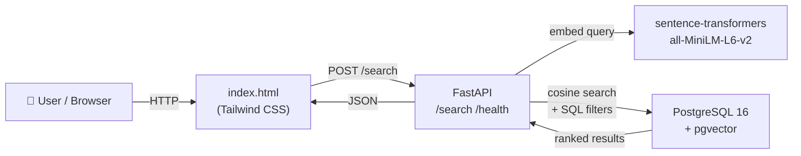

# JobPilot 🚀

AI-powered semantic job search engine — the foundation for a full job-matching agent.

> **⚠️ Synthetic Data:** The bundled dataset (`data/jobs.csv`) is **entirely synthetic**,
> generated by `scripts/load_jobs.py`. Company names, postings, and descriptions are
> fictional and for demonstration purposes only.

## Architecture



## Stack

| Layer | Technology |
|-------|-----------|
| Embeddings | `sentence-transformers/all-MiniLM-L6-v2` (384-d, local) |
| Vector DB | PostgreSQL 16 + pgvector (HNSW index) |
| API | FastAPI + Uvicorn |
| UI | Plain HTML + Tailwind CSS (CDN) |
| Container | Docker Compose |

## Quick Start

```bash
# 1. Clone & enter
git clone <repo-url> && cd jobpilot

# 2. Start services (builds image, downloads model, waits for PG)
docker compose up -d --build

# 3. Load synthetic jobs (generates CSV + embeds + inserts)
docker compose exec app python scripts/load_jobs.py

# 4. Open UI
open http://localhost:8000
```

## Example curl

```bash
curl -s -X POST http://localhost:8000/search \
  -H "Content-Type: application/json" \
  -d '{"query": "senior backend engineer with Python and Kubernetes", "top_k": 5}' | python -m json.tool
```

### With filters

```bash
curl -s -X POST http://localhost:8000/search \
  -H "Content-Type: application/json" \
  -d '{
    "query": "data engineer spark",
    "location": "Bengaluru",
    "remote_only": false,
    "max_experience": 5,
    "top_k": 3
  }' | python -m json.tool
```

## Incremental Refresh

```bash
# Add new rows to data/jobs.csv, then:
docker compose exec app python scripts/refresh_index.py
```

Skips duplicates (matched by title + company + location), embeds only new rows,
and refreshes the HNSW index.

## Project Structure

```
jobpilot/
├── app/
│   ├── main.py          # FastAPI app, routes, lifespan
│   ├── db.py            # SQLAlchemy models, pgvector setup
│   ├── embeddings.py    # sentence-transformers wrapper
│   ├── search.py        # Cosine search + SQL filters
│   ├── schemas.py       # Pydantic request / response models
│   └── static/
│       └── index.html   # Single-page UI (Tailwind)
├── scripts/
│   ├── load_jobs.py     # Generate synthetic data, embed, bulk insert
│   └── refresh_index.py # Incremental dedup insert + reindex
├── data/
│   └── jobs.csv         # Generated synthetic dataset (~2000 rows)
├── docker-compose.yml
├── Dockerfile
├── requirements.txt
├── .env.example
├── .gitignore
└── README.md
```

## Roadmap

- [x] Semantic search with pgvector cosine similarity + SQL filters
- [x] FastAPI REST API + single-page UI + Docker Compose
- [ ] Resume parsing with structured outputs (PDF → skills, experience)
- [ ] Tool-using LLM agent with memory (ReAct / function-calling)
- [ ] Hybrid ranking (semantic + BM25) + user personalization
- [ ] Eval harness (Precision@5, MRR, nDCG)

**Status:** 🟡 In progress
