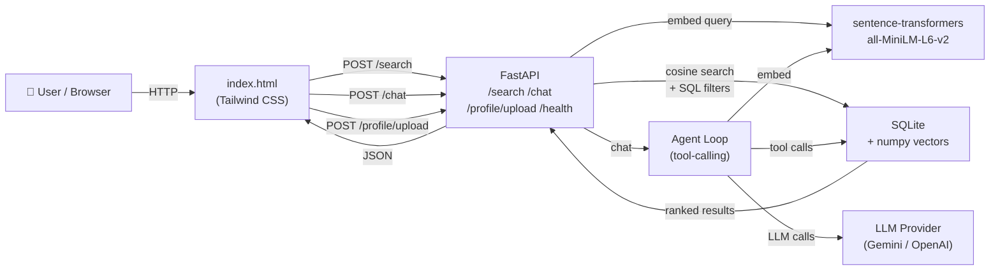

# JobPilot 🚀

AI-powered semantic job search engine with a tool-using LLM agent, resume parsing,
hybrid ranking, and an evaluation harness — the foundation for a full job-matching agent.

> **⚠️ Synthetic Data:** The bundled dataset (`data/jobs.csv`) is **entirely synthetic**,
> generated by `scripts/load_jobs.py`. Company names, postings, and descriptions are
> fictional and for demonstration purposes only.

## Architecture



## Stack

| Layer | Technology |
|-------|-----------|
| Embeddings | `sentence-transformers/all-MiniLM-L6-v2` (384-d, local, no API key) |
| Vector Search | numpy cosine similarity over SQLite-stored vectors |
| LLM | Google Gemini / OpenAI (configurable via `.env`) |
| API | FastAPI + Uvicorn |
| Agent | Tool-calling loop with 4 tools + persistent memory |
| UI | Plain HTML + Tailwind CSS (CDN, no build step) |
| Database | SQLite (zero setup) |

## Features

- **Semantic Search** — embed queries with all-MiniLM-L6-v2, cosine-rank against 2,000 job embeddings, apply SQL filters (location, experience, remote)
- **Resume Parsing** — upload a PDF resume, extract text with PyMuPDF, use an LLM with structured outputs (Pydantic schema) to build a user profile
- **LLM Agent** — tool-calling loop with `search_jobs`, `get_user_profile`, `save_preference`, and `rank_jobs` tools
- **Hybrid Ranking** — combines embedding similarity (50%), skill overlap with profile (35%), and stored preference boosts (15%)
- **Memory** — rolling conversation summary + recent messages + user preferences, persisted in SQLite, loaded at session start
- **Eval Harness** — 30 labeled test queries, Precision@5 and MRR metrics, LLM-as-judge for chat quality

## Quick Start

```bash
# 1. Clone & enter
git clone <repo-url> && cd jobpilot

# 2. Install dependencies
pip install -r requirements.txt

# 3. Configure (set your LLM API key)
cp .env.example .env
# Edit .env → set GOOGLE_API_KEY or OPENAI_API_KEY

# 4. Load synthetic jobs (generates CSV + embeds + inserts ~2000 jobs)
python scripts/load_jobs.py

# 5. Start the server
python -m uvicorn app.main:app --reload --port 8000

# 6. Open http://localhost:8000
```

## API Endpoints

| Method | Path | Description |
|--------|------|-------------|
| GET | `/health` | Health check |
| POST | `/search` | Semantic search with filters |
| POST | `/profile/upload` | Upload resume PDF → structured profile |
| POST | `/chat` | Chat with the LLM agent |
| GET | `/` | Web UI |

## Example Requests

### Search
```bash
curl -s -X POST http://localhost:8000/search \
  -H "Content-Type: application/json" \
  -d '{"query": "senior backend engineer Python Kubernetes", "top_k": 5}'
```

### Search with Filters
```bash
curl -s -X POST http://localhost:8000/search \
  -H "Content-Type: application/json" \
  -d '{"query": "data engineer spark", "location": "Bengaluru", "remote_only": false, "max_experience": 5, "top_k": 3}'
```

### Chat
```bash
curl -s -X POST http://localhost:8000/chat \
  -H "Content-Type: application/json" \
  -d '{"message": "Find me ML engineer roles in Bengaluru with PyTorch experience", "user_id": "default"}'
```

### Upload Resume
```bash
curl -s -X POST http://localhost:8000/profile/upload \
  -F "file=@resume.pdf" -F "user_id=default"
```

## Incremental Refresh

```bash
# Add new rows to data/jobs.csv, then:
python scripts/refresh_index.py
```

Skips duplicates (matched by title + company + location), embeds only new rows.

## Evaluation Results

Evaluated on 30 labeled test queries derived from the actual 2,000-job database.

| Method | Precision@5 | MRR |
|--------|------------|-----|
| Vector-only (cosine) | 0.3267 | 0.5395 |
| Hybrid (embedding + keyword) | **0.4067** | **0.6009** |

**Improvement:** Hybrid ranking improves Precision@5 by **+24.5%** (0.3267 → 0.4067) and MRR by **+11.4%** (0.5395 → 0.6009) over the vector-only baseline.

## Project Structure

```
jobpilot/
├── app/
│   ├── main.py          # FastAPI app, all routes, lifespan
│   ├── db.py            # SQLite schema, vector serialisation
│   ├── embeddings.py    # sentence-transformers wrapper
│   ├── search.py        # Cosine-similarity search + SQL filters
│   ├── schemas.py       # Pydantic request / response models
│   ├── profile.py       # Resume PDF parsing → structured profile
│   ├── llm.py           # LLM abstraction (Google / OpenAI)
│   ├── agent.py         # Tool-calling agent loop
│   ├── memory.py        # Preferences + conversation memory
│   └── static/
│       └── index.html   # Single-page UI (search + chat + upload)
├── scripts/
│   ├── load_jobs.py     # Generate synthetic data, embed, bulk insert
│   └── refresh_index.py # Incremental dedup insert
├── evals/
│   ├── generate_test_queries.py  # Build labeled test set from DB
│   ├── run_evals.py              # P@5, MRR, LLM-as-judge
│   ├── test_queries.json         # 30 test queries + ground truth
│   └── results/
│       └── eval_results.json     # Raw evaluation output
├── data/
│   ├── jobs.csv         # Generated synthetic dataset (~2000 rows)
│   └── jobpilot.db      # SQLite database
├── requirements.txt
├── .env.example
├── .gitignore
└── README.md
```

## Roadmap

- [x] Semantic search with cosine similarity + SQL filters
- [x] FastAPI REST API + single-page UI (search, chat, resume upload)
- [x] Resume parsing with structured outputs (PDF → skills, experience, roles)
- [x] Tool-using LLM agent with persistent memory
- [x] Hybrid ranking (embedding similarity + skill overlap + preferences)
- [x] Eval harness — Precision@5, MRR (30 queries), LLM-as-judge
- [ ] Containerised deployment (Docker Compose)

**Status:** 🟢 Core features complete
